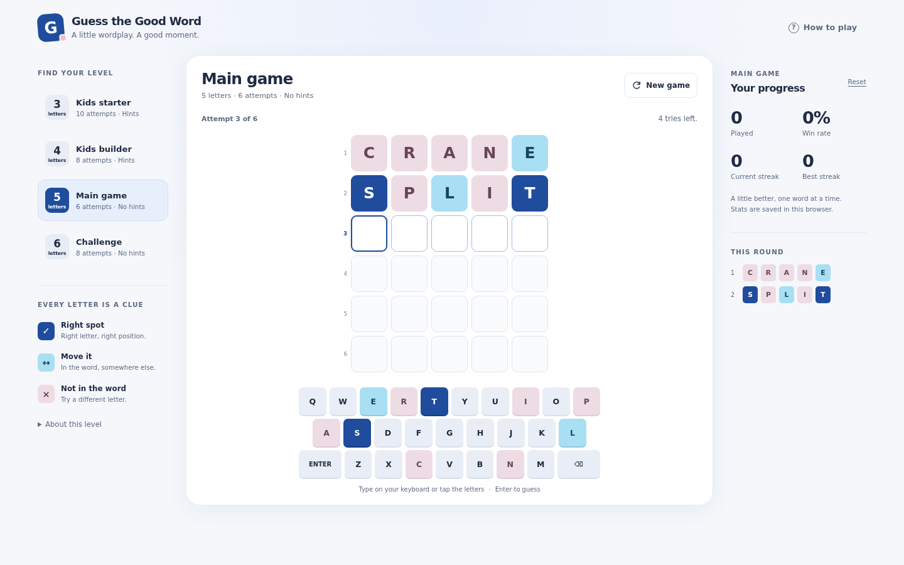

# Guess the Good Word

**Guess the Good Word** is a clean, browser-based word guessing game built with Python Flask, HTML, CSS, and vanilla JavaScript. It supports 3-, 4-, 5-, and 6-letter games, with gentler hint support for kids levels and a more classic challenge for longer words.

The app has a responsive one-page interface, a QWERTY keyboard, colored clues, curated answer pools, and separate validation dictionaries. It is lightweight enough to run locally on a school laptop, home desktop, or small development machine.

## Features

- 3-letter, 4-letter, 5-letter, and 6-letter word games
- Kids-friendly hint system for 3- and 4-letter levels
- Wordle-style scoring with correct duplicate-letter handling
- Broad validation dictionaries and smaller curated answer pools
- Clean Flask API with a simple HTML/CSS/JavaScript frontend
- No database required; active games are stored in memory
- Game-first layout with compact mobile level controls and Help/Stats dialogs
- Per-level browser stats, visual guess trails, and shareable results
- Optional clue symbols and reduced-motion support

## Responsive frontend

- The board and keyboard sit together in a responsive game panel. Tiles adapt to the available space, and very short screens can scroll without clipping the game.
- The active row and next-letter position are highlighted, with numbered attempts and inline progress messages. The 3-letter level uses a split board: attempts 1–5 on the left and 6–10 on the right.
- Dark blue marks correct positions, light blue marks misplaced letters, and soft pink marks absent letters. Enable **Add symbols to clues** in **How to play** for ✓, ↔, and × alongside color.
- Stats appear in a desktop sidebar or a mobile dialog. Kids levels include contextual hint guidance.
- Only the newest guess animates. Input is locked while a guess is checked, and network errors leave the entered word available to retry.
- Results show the answer, attempts used, and a visual share card, with **Play again**, **Copy result**, and a manual-copy fallback.

The frontend uses plain HTML, CSS, and JavaScript; no frontend build step is required.

## Levels

| Level ID | Display name | Word length | Tries | Accepted guess words | Random answer pool |
|---|---|---:|---:|---:|---:|
| `kids3` | 3 Letters | 3 | 10 | 333 | 283 |
| `kids4` | 4 Letters | 4 | 8 | 8,000 | 1,000 |
| `core5` | 5 Letters | 5 | 6 | 8,000 | 1,800 |
| `challenge6` | 6 Letters | 6 | 8 | 7,000 | 1,400 |

## Tech stack

| Layer | Technology |
|---|---|
| Backend | Python + Flask |
| Frontend | HTML, CSS, vanilla JavaScript |
| Testing | pytest |
| Word data | Plain `.txt` files inside `guess_the_good_word/data/` |
| Packaging | `pyproject.toml`, `requirements.txt`, `requirements-dev.txt` |

## Screenshot



The five-letter main game, showing color clues, the highlighted active row, the on-screen keyboard, and per-level progress.

## Project structure

```text
guess_the_good_word/
├── README.md
├── LICENSE
├── .gitignore
├── pyproject.toml
├── requirements.txt
├── requirements-dev.txt
├── run.py
├── docs/
│   ├── WORDLIST_MANIFEST.json
│   └── WORDLIST_NOTES.md
├── guess_the_good_word/
│   ├── __init__.py
│   ├── config.py
│   ├── dictionaries.py
│   ├── game.py
│   ├── routes.py
│   ├── data/
│   │   ├── words_3.txt
│   │   ├── answers_3.txt
│   │   ├── words_4.txt
│   │   ├── answers_4.txt
│   │   ├── words_5.txt
│   │   ├── answers_5.txt
│   │   ├── words_6.txt
│   │   └── answers_6.txt
│   ├── static/
│   │   ├── favicon.svg
│   │   ├── css/app.css
│   │   └── js/app.js
│   └── templates/
│       └── index.html
├── scripts/
│   ├── README.md
│   └── validate_wordlists.py
├── tests/
│   ├── test_dictionaries.py
│   ├── test_game.py
│   └── test_routes.py
└── wordle_3letter_code_files/
    ├── dictionaryCheck.js
    ├── validate_words_3.js
    ├── validate_words_3.py
    └── wordLists3.js
```

## Run on Linux / Ubuntu

```bash
sudo apt update
sudo apt install python3 python3-pip python3-venv git unzip -y

mkdir -p ~/projects
cd ~/projects
unzip ~/Downloads/guess_the_good_word_github_ready.zip
cd guess_the_good_word

python3 -m venv .venv
source .venv/bin/activate
python -m pip install --upgrade pip
python -m pip install -r requirements.txt

python run.py
```

Open this in your browser:

```text
http://127.0.0.1:5000
```

## Run on Windows PowerShell

Install Python 3 from python.org first. During installation, select **Add Python to PATH**.

```powershell
mkdir $HOME\projects
cd $HOME\projects
Expand-Archive $HOME\Downloads\guess_the_good_word_github_ready.zip -DestinationPath .
cd guess_the_good_word

py -m venv .venv
.\.venv\Scripts\Activate.ps1
py -m pip install --upgrade pip
py -m pip install -r requirements.txt

py run.py
```

Open this in your browser:

```text
http://127.0.0.1:5000
```

If PowerShell blocks activation, run this once, then activate again:

```powershell
Set-ExecutionPolicy -ExecutionPolicy RemoteSigned -Scope CurrentUser
```

## Run on macOS

Install Python 3 first. One common option is Homebrew:

```bash
brew install python
```

Then run:

```bash
mkdir -p ~/projects
cd ~/projects
unzip ~/Downloads/guess_the_good_word_github_ready.zip
cd guess_the_good_word

python3 -m venv .venv
source .venv/bin/activate
python -m pip install --upgrade pip
python -m pip install -r requirements.txt

python run.py
```

Open this in your browser:

```text
http://127.0.0.1:5000
```

## Run tests

```bash
python -m pip install -r requirements-dev.txt
python -m pytest -q
```

## Validate word lists

```bash
python scripts/validate_wordlists.py
```

## API examples

Get levels:

```bash
curl http://127.0.0.1:5000/api/levels
```

Start a game:

```bash
curl -X POST http://127.0.0.1:5000/api/game   -H "Content-Type: application/json"   -d '{"level_id":"core5"}'
```

## Upload this project to GitHub

Create a new empty repository on GitHub first. Do **not** initialize it with a README, because this project already has one.

Then run these commands from inside the project folder:

```bash
cd ~/projects/guess_the_good_word

git init
git add .
git commit -m "Initial commit: Guess the Good Word"
git branch -M main
git remote add origin https://github.com/YOUR-USERNAME/guess_the_good_word.git
git push -u origin main
```

Replace `YOUR-USERNAME` with your GitHub username.

For later updates:

```bash
git status
git add .
git commit -m "Update game"
git push
```

## Credits

Created and maintained by **Kathakali Seth**.

Coding, cleanup, documentation, and repository preparation assistance: **GPT-5.5 Thinking — High intelligence model**.

Built with **Python**, **Flask**, **HTML**, **CSS**, and **vanilla JavaScript**.

Inspired by classic word-guessing games and classroom-friendly vocabulary practice.

## License

This project is released under the MIT License. See [`LICENSE`](LICENSE).
